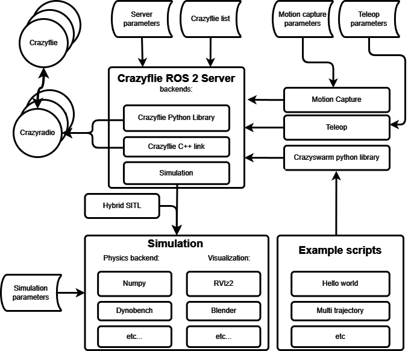

.. _overview:

Overview
========

This page will explain the overview of the crazyflie ROS 2 nodes:

Explanation per package
-----------------------

In the `source code of the Crazyswarm2 (Crazyflie ROS 2) project <https://github.com/IMRCLab/crazyswarm2>`_, there are several packages that we will explain here:

- **crazyflie/**: The package that contains the crazyflie server nodes and the crazyflies.yaml.
- **crazyflie_py/**: The package that contains the python library that wraps around the ROS 2 services and topics that connects with the crazyflie server nodes.
- **crazyflie_examples/**:  The package that contains examples of using the crazyflie ROS 2 package. See :ref:`tutorials`.
- **crazyflie_interfaces/**: The package that contains all msgs and srvs for the crazyflie ROS 2 project.
- **crazyflie_sim/**: The package that contains our simulator.

Crazyflie server
----------------

The crazyflie server node connects multiple `Crazyflies <https://www.bitcraze.io/products/crazyflie-2-1/>`_ with on or more `Crazyradio PA dongles <https://www.bitcraze.io/products/crazyradio-pa/>`_.

It has four backends that you can choose from:

- **cpp**: This is based on the `crazyflie-link-cpp <https://github.com/bitcraze/crazyflie-link-cpp>`_ on the lowest layer.
- **cflib**: This is based on the `crazyflie-lib-python <https://www.bitcraze.io/documentation/repository/crazyflie-lib-python/master/>`_ up until the logging, parameter, and command sending handling.
- **cflib2**: This is based on the `crazyflie-lib-python-v2 <https://github.com/bitcraze/crazyflie-lib-python-v2>`_, an async-first, Rust-powered rewrite of cflib. It is work in progress and currently only implements the takeoff and land services.
- **sim**: Our simulator behaves like a regular backend, offering ROS 2 topics and services, see below for more details on the simulation.

It handles several low level communication aspects with the Crazyflies:

- **Parameter to ROS 2 parameters handling**: It receives the parameter ToC from the Crazyflie, transforms it into ROS 2 parameters, and sets the CF2 parameters based on the *crazyflies.yaml* input.
- **Logging to ROS 2 topics handling**: The server sets up logblocks for data streaming in the crazyflie, and transforms the received variables into ROS 2 topics.
- **Run-time configuration**: Both parameters and logging can be configured in run-time while the server is connected with the Crazyflies. Please check :ref:`usage`.

It also setups several flight command services:

- **Takeoff / Land / GoTo**: With a single service command and a given height or coordinate, you can make the connected crazyflies take off, go to a position and land.
- **Upload / Start trajectory**: You can upload a predefined trajectory and indicate if the Crazyflies need to start flying it.
- **Emergency** : To turn off the motors in case something goes wrong.
- **/all or /cf2** : The services are setup either for all crazyflies to respond to, or each individual crazyflie, depended on the prefix.

Simulation
----------

The simulator uses the Crazyflie firmware as a software-in-the-loop (SIL). It provides the same ROS interface as the server and therefore can be used with C++ or Python user code.

Currently, the desired setpoint is visualized in rviz (see :ref:`usage`) or a simple physics-based simulator can be used.

Support functionality with backends
-----------------------------------

+---------------------+---------+-----------+---------+------------+
| **Functionality**   | **Cpp** | **CFlib** | **Sim** | **CFlib2** |
+=====================+=========+===========+=========+============+
| Parameters          | Yes     | Yes       | No      | No         |
+---------------------+---------+-----------+---------+------------+
| Logging                                                          |
+---------------------+---------+-----------+---------+------------+
| - default: pose     | Yes     | Yes       | No      | No         |
+---------------------+---------+-----------+---------+------------+
| - default: scan     | Yes     | Yes       | No      | No         |
+---------------------+---------+-----------+---------+------------+
| - default: odom     | Yes     | Yes       | No      | No         |
+---------------------+---------+-----------+---------+------------+
| - default: status   | Yes     | Yes       | No      | No         |
+---------------------+---------+-----------+---------+------------+
| - default: imu      | Yes     | Yes       | No      | No         |
+---------------------+---------+-----------+---------+------------+
| - custom            | Yes     | Yes       | No      | No         |
+---------------------+---------+-----------+---------+------------+
| - Add/Remove Srv    | No      | Yes       | No      | No         |
+---------------------+---------+-----------+---------+------------+
| Broadcasts          | Yes     | No        | n/a     | No         |
+---------------------+---------+-----------+---------+------------+
| Manual control                                                   |
+---------------------+---------+-----------+---------+------------+
| - cmd_full_state    | Yes     | Yes       | Yes     | No         |
+---------------------+---------+-----------+---------+------------+
| - cmd_position      | Yes     | Yes       | No      | No         |
+---------------------+---------+-----------+---------+------------+
| - cmd_hover         | Yes     | Yes       | No      | No         |
+---------------------+---------+-----------+---------+------------+
| - cmd_velocity_world| Yes     | Yes       | No      | No         |
+---------------------+---------+-----------+---------+------------+
| High-level control                                               |
+---------------------+---------+-----------+---------+------------+
| - takeoff/land      | Yes     | Yes       | Yes     | Yes        |
+---------------------+---------+-----------+---------+------------+
| - go_to             | Yes     | Yes       | Yes     | No         |
+---------------------+---------+-----------+---------+------------+
| - upload/start traj | Yes     | Yes       | Yes     | No         |
+---------------------+---------+-----------+---------+------------+
| Positioning System                                               |
+---------------------+---------+-----------+---------+------------+
| - Motion Capture    | Yes     | Yes       | No      | No         |
+---------------------+---------+-----------+---------+------------+
| - Flow Deck         | Yes     | Yes       | No      | Yes        |
+---------------------+---------+-----------+---------+------------+
| - LightHouse        | Yes     | Yes       | No      | No         |
+---------------------+---------+-----------+---------+------------+
| - LPS               | Yes     | Yes       | No      | No         |
+---------------------+---------+-----------+---------+------------+
| Misc                                                             |
+---------------------+---------+-----------+---------+------------+
| - Arming            | Yes     | Yes       | n/a     | No         |
+---------------------+---------+-----------+---------+------------+

.. note::

    The **cflib2** backend is work in progress and currently only implements the
    takeoff and land services. In particular, the firmware parameters from
    *crazyflies.yaml* (including ``commander.enHighLevel``) are not uploaded yet,
    so the high-level commander needs to be enabled on the Crazyflies already.
